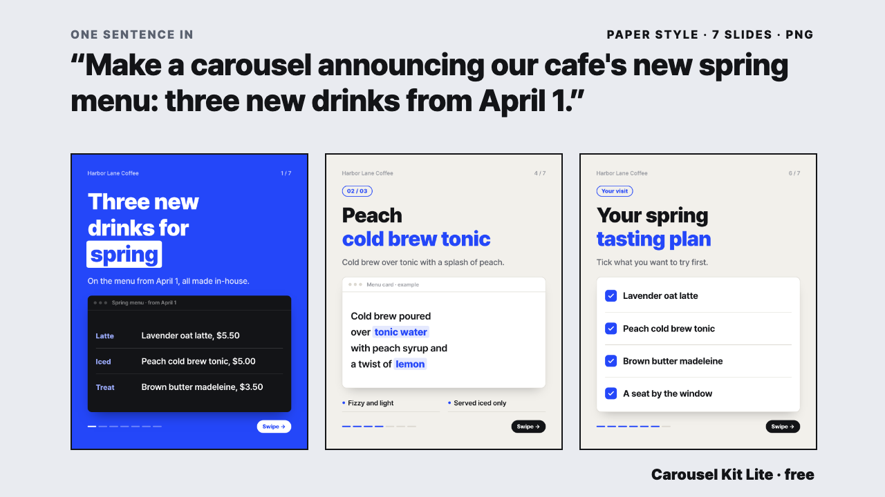

# Carousel Kit Lite



**Tell Claude Code "make a carousel about X" and get a multi-slide Instagram post as PNG images.** You don't need to know how to program. Installation is one pasted prompt.

Your text can be English or Korean (the bundled Pretendard font covers Latin and Korean).

## Lite and the full kit

Lite is a free, smaller version of the paid Carousel Kit. It is complete for what it does, not a trial with a timer.

| | Lite (this) | Full Carousel Kit |
| --- | --- | --- |
| Styles | 1 (Paper) | 7 (Paper, Midnight, Neon Block, Chat Screen, Studio Minimal, Data Bento, Pixel Game) |
| Output | PNG slides, phone preview, contact sheet | the same, plus one animated MP4 per slide (no sound) |
| Automatic checks | yes | yes |

The full kit is here if you ever want it: https://contentcraft648.gumroad.com/l/byvwg

## What's inside

| Folder / file | What it does |
| --- | --- |
| `skills/carousel-engine` | Plan, slide outline, copy, render to PNG, automatic checks (content overflow, text that is too small, awkward line breaks, big empty areas), a phone-size preview of each slide and one contact sheet of the whole set |
| `skills/carousel-starter` | A ready-to-use neutral design kit with one style, Paper, and a 7-slide sample |
| `examples/starter-sheet.png` | Real output: the sample set, 7 slides |
| `INSTALL-PROMPT.txt` | The installation prompt to paste into Claude Code |

Font: **Pretendard** is included (SIL OFL 1.1). The license text is `OFL-Pretendard.txt` in `skills/carousel-engine/shared/fonts/`.

## What you need

| Requirement | How to check | If missing |
| --- | --- | --- |
| Claude Code or Codex (OpenAI Codex CLI) | The one you already use | - |
| Node.js 18 or newer (includes npm) | `node -v` in a terminal | Install the LTS version from https://nodejs.org |
| Chrome (Edge or Chromium also work) | Your usual browser | https://www.google.com/chrome |
| Internet | Only once, during install (`npm install`) | After that, everything runs offline |

## Installation (one prompt)

1. Get the files: `git clone` this repository, or use **Code > Download ZIP** on GitHub and unzip it.
2. Open Claude Code in that folder (in a terminal, `cd` into the folder and run `claude`, or open the folder in VS Code and start Claude Code).
3. Open `INSTALL-PROMPT.txt` in that folder, copy all of it, and paste it in. If you prefer a single line, paste this instead:

> Read INSTALL-PROMPT.txt in this folder, then install and test everything in the order it describes.

Claude Code copies the two skills to `~/.claude/skills/`, runs `npm install`, renders a test carousel and reports back. If a skill with the same name already exists, it asks before overwriting.

Claude Code is careful about anything under `~/.claude/`, so a **permission prompt** will appear before the copy. Allow it and it carries on. If it stops with a "permission denied" message, run the copy command below yourself, then tell Claude Code: "I copied the skills myself. Continue from step 3 of INSTALL-PROMPT.txt."

macOS / Linux (from the kit folder; an existing skill with the same name is not overwritten)

```
mkdir -p ~/.claude/skills && cp -Rn skills/carousel-engine skills/carousel-starter ~/.claude/skills/
```

Windows (PowerShell, from the kit folder. This exact command was not tested. Copying the two folders inside `skills` into `%USERPROFILE%\.claude\skills\` in File Explorer does the same thing)

```
New-Item -ItemType Directory -Force "$env:USERPROFILE\.claude\skills" | Out-Null; Copy-Item -Recurse skills\carousel-* "$env:USERPROFILE\.claude\skills\"
```

### Using it with Codex

Codex uses the same skill folders. Copy them into `~/.codex/skills/` (on Windows `%USERPROFILE%\.codex\skills\`; if you set `CODEX_HOME` yourself, `$CODEX_HOME/skills`):

```
mkdir -p ~/.codex/skills && cp -Rn skills/carousel-engine skills/carousel-starter ~/.codex/skills/
```

Then open Codex fresh and say "make a carousel about X". You can also paste `INSTALL-PROMPT.txt` into Codex; step 2 tells it to copy to `.codex/skills`. Commands inside the skill documents use `~/.claude/skills/...` paths; in Codex, read them as `~/.codex/skills/...`. This kit has not been tested in Codex.

## How to check it worked

1. **Skills copied**: `~/.claude/skills/` contains `carousel-engine` and `carousel-starter`.
2. **No warnings**: the test render printed `Auto-check: no warnings`.
3. **7 PNGs**: the test set's `out/` folder has `01-cover.png` through `07-closing.png`.
4. **Look at it**: `preview/sheet.png` shows seven slides that resemble `examples/starter-sheet.png`.
5. **A fresh chat recognises it**: open Claude Code anew, say "make a carousel", and it reads the carousel skill.

## Make your first carousel

Tell Claude Code:

> Make a carousel about "(my topic)". The audience is (who), and after they finish I want them to (save it / message me / follow). Use the starter kit.

What Claude Code does: (1) writes a slide outline (`plan.md`) first, (2) creates a set folder and fills in the copy, (3) renders the PNGs and fixes any warnings, (4) checks the contact sheet. The result lands in the set folder:

```
<set folder>/
  cards.html          the slides (edit only this; the PNGs change with it)
  out/01-cover.png …  the PNGs to post on Instagram (1080x1350)
  preview/sheet.png   one contact sheet of every slide
```

**Make it yours**: say "In the starter kit, change the channel name to X, the handle to @Y and the accent colour to #RRGGBB." (It edits `carousel-starter/kit/kit.json` and the `--accent` line at the top of `kit/starter.css`.)

**Posting**: this kit does not publish anything. You upload the finished PNGs in the Instagram app yourself (up to 20 slides per post).

## Principles it follows

- The cover has one visual anchor / one message per slide / the number of slides follows the content (4-15) / no invented statistics or testimonials (sample screens are labelled "example").

## Using another font

Download a font file (.ttf/.otf) yourself (redistribution and commercial-use terms differ per font, so check), put it in `~/.claude/skills/carousel-engine/shared/fonts/`, and add one line to `fonts.css` one folder up:

```css
@font-face { font-family: "MyFont"; font-weight: 400; src: url("fonts/MyFont-Regular.ttf"); }
```

Then, in `~/.claude/skills/carousel-starter/kit/starter.css`, replace `"Pretendard"` with `"MyFont"`. Or ask Claude Code: "register this font and use it in the starter."

## Windows and Linux

Only macOS was run for this version. Chrome and Edge in the usual Program Files / `/usr/bin` locations are found automatically; if Chrome isn't found, set `CHROME_PATH` to the executable (`export CHROME_PATH=...` or PowerShell `$env:CHROME_PATH="C:\…\chrome.exe"`). These notes come from reading the code, not from running it.

## Common problems

| Symptom | Cause and fix |
| --- | --- |
| `playwright-core is missing` | `npm install` hasn't been run in `~/.claude/skills/carousel-engine/scripts`. Tell Claude Code: "run npm install in that folder" |
| `Chrome not found` | Chrome isn't installed or isn't in a default location. Install it, or put the full path in `CHROME_PATH` |
| `Folder already has content (not overwritten)` | That set folder name is already in use. Choose another name |
| Warning: `content overflows the card` | The text is too long. Shorten the copy or split the slide |
| Warning: `text smaller than 24px` | Make that text bigger or remove it |
| Warning: `empty band` | A stretch of 20% or more of the card has no text and no visual. Add a screen frame, diagram or big-number panel, or rebalance. If on purpose, add `data-allow-gap` to that card's `<section>` |
| Warning: `awkward line break` / `word split mid-word` | Move the `<br>` or shorten or reword the copy |
| Warning: `image did not load` | A picture's path is wrong or the file is missing |
| You edited the copy but the image didn't change | Run the render command again and check the "last modified" time on the first line of the output |
| Double-clicking `cards.html` shows broken fonts | Normal. Run `render.cjs <set folder> --serve` and open the address it prints |
| Chrome opens and asks about a keychain | It shouldn't: the renderer uses a throwaway Chrome profile and a mock keychain. If it happens, stop and don't enter your password |
| Claude Code doesn't know the new skills | Open Claude Code fresh and start a new conversation |

## What was tested and what wasn't

- Tested (macOS, by hand): unzipped the kit (the same files as this repository) into a throwaway home folder, copied the two skills, ran `npm install`, created a set from the starter sample and rendered it (7 PNGs, no warnings), and rendered a second sample set.
- Looked at by eye: the contact sheet and the sample PNGs.
- Not tested: pasting the install prompt into Claude Code and clicking through permission prompts (steps were run by hand), Codex, Windows, Linux, posting in the Instagram app.
- Not tested with English readers: the style was designed by a Korean studio. Look at the sample and decide if it suits your brand.
- Not included in Lite: other styles, video, sound, automatic photo or artwork generation, automatic posting.

## Version

v1 Lite. One style (Paper: light background, one strong accent colour, boldest two-line headline, a screen frame filling half the card, progress bar and swipe button). The skills are instruction documents that Claude Code reads plus small scripts. They connect to no outside service (only `npm install` uses the internet, once, during setup).

## License

Free to use, and free to use what you make with it, including for paid work. Please don't redistribute or resell the kit itself; link to this repository instead. See [LICENSE](LICENSE). The Pretendard font is under the SIL Open Font License 1.1.
